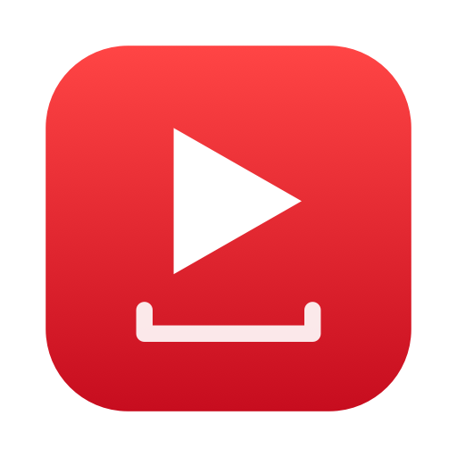
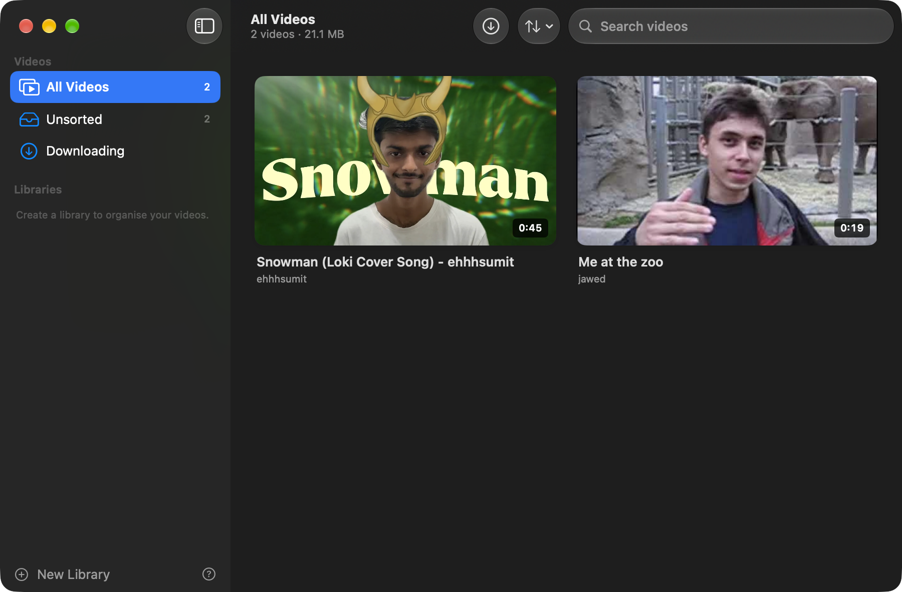

<div align="center">



# TubeVault

**Save YouTube videos to your Mac in one click and watch them offline.**

[](https://github.com/SyedInayatShah/TubeVault/actions/workflows/build.yml)
[](https://github.com/SyedInayatShah/TubeVault/releases/latest)


### ⬇️ Download

[**TubeVault.zip**](https://github.com/SyedInayatShah/TubeVault/releases/latest/download/TubeVault.zip) — the Mac app &nbsp;·&nbsp;
[**TubeVault-Chrome-Extension.zip**](https://github.com/SyedInayatShah/TubeVault/releases/latest/download/TubeVault-Chrome-Extension.zip) — the Chrome download button

<br>



</div>

---

## ✨ Features

- **Download button in the YouTube player.** It sits in the video's bottom control bar, next to the subtitles and settings icons, with a live progress bar beside it.
- **Open TubeVault button.** When a download finishes, the player button becomes **Open TubeVault**. Clicking it opens the app at that video.
- **Pick up where you paused.** Pause a video on YouTube that you've downloaded, open TubeVault, and the video is waiting, paused at the same second.
- **Best quality, always, and fast.** Each video downloads at the highest resolution YouTube offers, up to 4K, fetched over 8 connections at once so it goes as fast as your internet allows. Videos you click download before Save all Shorts.
- **Whole playlists, in your order.** On any playlist, click the ⬇ button next to loop and shuffle (or next to Save and Share on the playlist page). Pick the videos in the order you want them: that's the order they download in and play in. **Select All** takes the rest. They save as separate videos inside one playlist in the app, which plays them straight through. A small card in the bottom-left corner of YouTube follows the download.
- **YouTube Shorts.** A ⬇ **Save** button sits above the like button on every Short and fills up red as it downloads. Saved Shorts get their own **Shorts** feed in the app: one at a time, looping, scroll or press ↑ ↓ to move between them. It reopens on the Short you watched last.
- **Save all Shorts from your feed.** Under **Save** there's a **Save all** button. It saves up to 1000 Shorts from your own Shorts feed, skipping the next 150 (you'd scroll through those on YouTube anyway), so TubeVault has the same kind of Shorts you watch without repeating the ones you're about to see. Shorts you scroll to on YouTube while it runs are left out too. Nothing has to play: it reads your feed from YouTube with your sign-in. It keeps going until it reaches 1000, you click **Stop**, or you close that YouTube tab. Your Mac stays awake while it downloads. Sponsored Shorts (ads) are skipped. Then scroll through them offline in TubeVault's **Shorts** feed, in the same order; a small flick moves one Short, like on YouTube.
- **Chrome and Safari.** The same extension works in both. Safari loads it as a temporary extension (see [setup step 4](#4--or-use-safari)).
- **Resume anywhere.** Close a video in TubeVault and it continues from the same spot next time.
- **Automatic updates.** When a new version is released, TubeVault shows a notification and a banner. Click **Update Now** and it installs itself and restarts.
- **Offline library.** Open TubeVault from your Dock to see only your downloaded videos. It works with no internet.
- **Downloading tab** with progress, speed, time left, cancel and retry.
- **Libraries.** Make your own collections and drag videos into them.
- **Built-in player** with full screen and Picture in Picture.
- Videos are stored inside TubeVault’s own app folder, not in Downloads. To see the `.mp4` files, use **View › Show Video Files in Finder**.

---

## 🚀 Setup (about 3 minutes)

### 1. Install the app

1. Download **[TubeVault.zip](https://github.com/SyedInayatShah/TubeVault/releases/latest/download/TubeVault.zip)** and double-click it to unzip.
2. Drag **TubeVault.app** into your **Applications** folder.
3. Open it. To keep it in your Dock, right-click its Dock icon › **Options** › **Keep in Dock**.

The first time it opens, TubeVault sets up its download engine by itself: the free tools [yt-dlp](https://github.com/yt-dlp/yt-dlp), ffmpeg and deno, about 130 MB, from their official releases. No Homebrew or Terminal needed. It keeps yt-dlp up to date too. If you already installed them with Homebrew, TubeVault uses those.

### 2. 🔒 If macOS blocks TubeVault

TubeVault isn't from the App Store, so the first time you open it macOS may say **"Apple could not verify TubeVault is free of malware"** or **"TubeVault is damaged and can't be opened"**. To allow it:

1. On the warning, click **Done** (not *Move to Trash*).
2. Open  **System Settings** › **Privacy & Security**.
3. Scroll down to the **Security** section. Next to *"TubeVault" was blocked to protect your Mac*, click **Open Anyway**.
4. Enter your Mac password, then click **Open Anyway** again.

<details>
<summary><b>Still blocked, or it says "damaged"?</b></summary>

Paste this into Terminal, then open TubeVault again:

```bash
xattr -dr com.apple.quarantine /Applications/TubeVault.app
```

This removes the "downloaded from the internet" flag macOS adds to files from the web. You only need to do it once per update.
</details>

### 3. 🧩 Add the download button to Chrome

The extension isn't on the Chrome Web Store, so you load it with Chrome's **Developer mode**.

1. Download **[TubeVault-Chrome-Extension.zip](https://github.com/SyedInayatShah/TubeVault/releases/latest/download/TubeVault-Chrome-Extension.zip)** and unzip it. You'll get a folder called **TubeVault Chrome Extension**. Move it somewhere permanent, like your Documents folder. Chrome loads it from there, so don't delete it.
   > Or, in TubeVault, open **Help › TubeVault Setup Guide** and click **Save Extension**. That puts a **TubeVault Chrome Extension** folder in your **Documents** for you.
2. In Chrome, type **`chrome://extensions`** in the address bar and press Return.
3. **Turn on Developer mode** with the toggle in the **top-right corner** of the page. Three new buttons appear on the left.
4. Click **Load unpacked**, select the **TubeVault Chrome Extension** folder, and click **Select**.
5. *(Optional)* Click the 🧩 puzzle icon in Chrome's toolbar and **pin** TubeVault.

You're done. Open any YouTube video and look for the **⬇ download icon** in the player's bottom bar.

> You'll see a "Developer mode extensions" notice now and then when Chrome starts. That's normal for extensions not from the Web Store. Just close it.

### 4. 🧭 Or use Safari

Safari uses the same extension folder as Chrome, with the same buttons: the player ⬇, Shorts **Save** and **Save all**, playlists, and the right-click menu.

1. Get the **TubeVault Chrome Extension** folder (step 3.1 above, or **Save Extension** in TubeVault's setup guide).
2. In Safari, open **Settings › Advanced** and turn on **Show features for web developers**.
3. Open **Settings › Developer**, click **Add Temporary Extension…**, choose the **TubeVault Chrome Extension** folder and enter your Mac password if asked.
4. On YouTube, click the TubeVault icon next to the address bar and choose **Always Allow on This Website**, then refresh the page.

> **Safari removes temporary extensions when it quits**, so repeat step 3 after restarting Safari. In Safari, keep TubeVault open while you download: the extension can't start the app for you there.

**All of these steps (Chrome and Safari) are also in the app.** TubeVault shows them the first time you open it, and you can reopen them from **Help › TubeVault Setup Guide** or the **?** button at the bottom of the sidebar.

---

## 🎬 Using it

| Want to… | Do this |
| --- | --- |
| Download the video you're watching | Click the **⬇** icon in the YouTube player's bottom bar. A red progress bar shows next to it. |
| Watch it in TubeVault | When it's saved, click the red **Open TubeVault** button in the player bar. The app opens the video paused at the same spot. |
| Continue later | Pause on YouTube, then open TubeVault from the Dock. It jumps to that video, paused where you stopped. |
| Download a playlist | Click the **⬇** next to the playlist's loop and shuffle buttons (or next to **Save** and **Share** on a playlist page). Click the videos in the order you want, or **Select All**, then **Download**. |
| Watch a playlist | Click it under **Playlists** in TubeVault's sidebar, then **Play All**. Each video moves on to the next one. |
| Download a Short | Click **Save** above the like button. It fills up red, then shows ✓ **Saved**. Click it again to open the Short in TubeVault. |
| Save Shorts from your feed | On any Short, click **Save all** (under **Save**). It skips the next 150 and saves up to 1000 after them. A card in the bottom-left corner counts them up to 1000; click **Stop** to end early, or just close the tab. Shorts take roughly 5–30 MB each (4K ones can be over 100 MB), so 1000 can be 10–30 GB or more; it stops by itself if your Mac gets low on space. |
| Watch your Shorts | Click **Shorts** in TubeVault's sidebar, then scroll, swipe or press **↑ ↓**. Click a Short (or press **space**) to pause it. Hover the speaker at the top left for a volume slider; **M** mutes. |
| Download from a thumbnail | Right-click the thumbnail › **Download with TubeVault** |
| Download from Safari or another app | Right-click a YouTube link › **Services › Download with TubeVault** |
| Paste a link | Press **⌘D** in TubeVault |
| Watch offline | Open **TubeVault** from your Dock and click any video |
| Organise | Click **New Library**, then drag videos onto it (or right-click › **Move to Library**) |
| Delete a playlist | Right-click it under **Playlists** › **Delete Playlist…**, then delete its videos too or keep them in Unsorted |
| Delete several at once | Right-click **All Videos** or **Shorts** › **Delete Videos…** / **Delete Shorts…**, click the ones to remove (or **Select All**), then **Delete** |
| Check progress | Click **Downloading** in the sidebar |

Downloads keep running if you close the window. To delete a video, right-click it › **Delete Download**.

### Updating

TubeVault checks for new versions on its own (also **Help › Check for Updates…**). Click **Update Now** in the notification or the banner and it installs itself.

If you saved the extension from TubeVault's setup guide (**Documents › TubeVault Chrome Extension**), the update refreshes that folder too. Chrome uses the new version after a restart, or right away if you click **↻ reload** on the TubeVault card in `chrome://extensions`.

> **Upgrading from 1.1 or earlier?** Version 1.2 gives the extension a permanent ID so it can talk to the app directly. Remove the old TubeVault card in `chrome://extensions`, then **Load unpacked** the new folder once.

---

## 🩺 Troubleshooting

| Problem | Fix |
| --- | --- |
| The button shows **Failed – retry** right away | YouTube may be asking to *confirm you're not a bot*. TubeVault 1.2.1+ works around this automatically. If macOS asks to let TubeVault use **Chrome Safe Storage**, click **Always Allow** so it can use your YouTube sign-in. If it still fails, quit and reopen TubeVault: it checks for a newer yt-dlp every day. |
| The button stays on **Starting…** | Make sure you loaded the 1.2+ extension (remove the old card in `chrome://extensions` first), then refresh the YouTube tab. |
| You can see why a download failed | Open TubeVault's **Downloading** section. The full error is shown under the video. |

## 🛠 Build from source

Requires Xcode 15+ (or the Swift 5.10 toolchain).

```bash
git clone https://github.com/SyedInayatShah/TubeVault.git
cd TubeVault
./scripts/build-app.sh
cp -R build/TubeVault.app /Applications/
```

Then load the `extension/chrome` folder in Chrome as described above.

### How it works

| Piece | Where |
| --- | --- |
| SwiftUI app | `Sources/TubeVault` |
| Download engine (runs yt-dlp, reads progress) | `Sources/TubeVault/DownloadManager.swift` |
| Sets up yt-dlp, deno and ffmpeg on first launch, checks their checksums and signatures, and keeps yt-dlp current | `Sources/TubeVault/ToolInstaller.swift` |
| Bridge Chrome uses to talk to the app; opens TubeVault if it's closed | `Sources/TubeVault/NativeHost.swift` |
| Local server for progress and positions (`127.0.0.1:47823`, only accepts the extension) | `Sources/TubeVault/LocalServer.swift` |
| In-app setup guide | `Sources/TubeVault/SetupGuideView.swift` |
| Chrome extension (player button, right-click menu) | `extension/chrome` |
| Playlist button, picker and progress card | `extension/chrome/playlist.js` |
| Library data | `~/Library/Application Support/TubeVault/library.json` |
| Video files and thumbnails | `~/Library/Application Support/TubeVault/Videos` and `…/Thumbnails` |
| CI build and releases | `.github/workflows/build.yml`. Push a `v*` tag to publish a release. |

Videos download as H.264/AAC MP4 (up to 1080p) so they play natively on any Mac.

---

<sub>Only download videos you have the right to save, and respect YouTube's Terms of Service.</sub>
